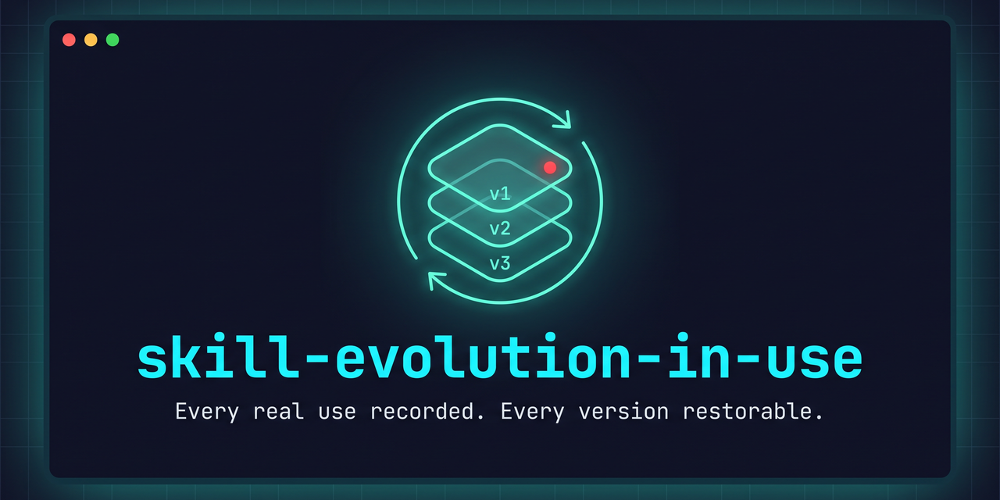

English | [简体中文](README.zh-CN.md)

<div align="center">

# skill-evolution-in-use



**Record every real conversation that uses a Claude Code skill, and roll that skill back to any version.**

[](LICENSE)
[]()
[]()
[]()

</div>

---

## Features

1. **See how a skill is really used.** Every conversation that calls it is saved beside the skill, so you can read what was asked and what you had to correct.
2. **Undo any change to a skill.** Each edit becomes a numbered version. You can go back to any of them, and a rollback can itself be undone.
3. **No cost while you work.** Recording adds no tokens and prints nothing into your session.
4. **Your conversations stay on your machine.** Records live in the skill's own folder and are kept out of git.
5. **Every record names the version it ran on.** When you fix the skill later, you know which text led to which complaint.

---

## What It Is

A Claude Code skill. You pick a skill you want to improve and turn this on for it. From then on, every session that invokes that skill is copied into `<skill>/evolve/records/`: your messages and Claude's replies word for word, one line per tool call, and any tool errors. The skill's files are stored as numbered versions, and you can restore any of them by asking in plain language.

I built it because test prompts never show what real use shows. The things you correct by hand, again and again, are the best evidence of what a skill gets wrong, and they disappear when the window closes.

This release records and keeps versions. It does not edit your skills. The next stage turns the records into proposed edits, with an independent review and your approval for anything that is a matter of taste. That stage is being tested by hand and is not part of this release.

---

## See It in Action

You keep a skill called `slide-maker`. Turn it on:

```
You ❯ Turn on evolution for slide-maker

[skill-evolution-in-use] enabled: slide-maker · v1 · 3 files stored
[skill-evolution-in-use] data folder: ~/.claude/skills/slide-maker/evolve/
[skill-evolution-in-use] hooks: installed in ~/.claude/settings.json (Stop, SessionEnd); recording starts in the NEXT Claude Code session (hooks load at session start)
[skill-evolution-in-use] the skill's own files were not modified
```

Over the next few days you use it three times. Twice you tell Claude the same thing: the titles are too long, keep them to one line. Both corrections are in the records, word for word:

```
## Turn 2 · 11-16 10:00

**User**

> Again two-line titles. One line please
```

Between two uses you tighten `references/layout.md` by hand. Then a later edit breaks the skill:

```
You ❯ slide-maker is broken, go back to the previous version

[skill-evolution-in-use] unsaved edits were stored first as v3
[skill-evolution-in-use] rolled back: slide-maker now has the content of v2, stored as v4
[skill-evolution-in-use] to undo this rollback: evo.py rollback slide-maker v3

You ❯ How is slide-maker doing?

[skill-evolution-in-use] slide-maker
  state      enabled · unlocked · v4
  live copy  matches v4
  records    3 file(s) · 2 KB · latest 2026-11-16 10:00
  versions   v1 (enable) · v2 (external) · v3 (external) · v4 (rollback)
  recent     v2 · 2026-11-16 10:00 · external — edited outside skill-evolution-in-use (noticed when the skill was used)
  recent     v3 · 2026-11-16 10:00 · external — unsaved edits stored before a rollback
  recent     v4 · 2026-11-16 10:00 · rollback — restored the content of v2
  folder     ~/.claude/skills/slide-maker/evolve/ · 7 KB
  hooks      installed (Stop, SessionEnd)
```

Your hand edit was picked up as v2 the next time the skill ran. The broken state is kept as v3 in case you want it back. Nothing was lost. The output above comes from a real run on a test skill; only the folder paths were shortened.

---

## Repository Structure

```text
skill-evolution-in-use/
├── SKILL.md                 # what Claude reads: when to use this skill and which command fits each request
├── scripts/
│   ├── evo.py               # the command line; each request type in SKILL.md maps to one subcommand
│   ├── evo_core.py          # the code behind every evo.py command
│   └── record_hook.py       # runs after each reply and when a window closes; writes the records
├── references/
│   └── record-format.md     # layout of a record and of the evolve/ folder
├── evals/
│   └── evals.json           # three test prompts with checks, used while building the skill
├── tests/
│   └── test_p1.py           # 101 unit tests; they run in temporary folders and never touch ~/.claude
├── docs/
│   ├── hero-en.png          # banner for this README
│   └── hero-zh.png          # banner for the Chinese README
├── .gitignore               # keeps Python caches and any evolve/ folder out of git
├── LICENSE                  # MIT
├── README.md                # this file
└── README.zh-CN.md          # Chinese README
```

---

## Install

Needs Claude Code, Python 3.9 or newer, and macOS or Linux.

```bash
git clone https://github.com/Zane456/skill-evolution-in-use ~/.claude/skills/skill-evolution-in-use
```

Then, in Claude Code, say "Turn on evolution for &lt;your-skill&gt;". The first time, it adds two hooks to `~/.claude/settings.json` (a backup is written next to it). If [skill-checkup](https://github.com/Zane456/skill-checkup) is not installed, it downloads it, because the next stage checks edits with it. If the download fails, enabling goes ahead without it. Recording starts in your next Claude Code session.

To stop: "Turn off evolution for &lt;your-skill&gt;" stops recording, and `python3 ~/.claude/skills/skill-evolution-in-use/scripts/evo.py uninstall-hooks` removes the hooks.

Run the tests:

```bash
python3 ~/.claude/skills/skill-evolution-in-use/tests/test_p1.py
```

<div align="center">

MIT License © [Zane456](https://github.com/Zane456)

</div>
