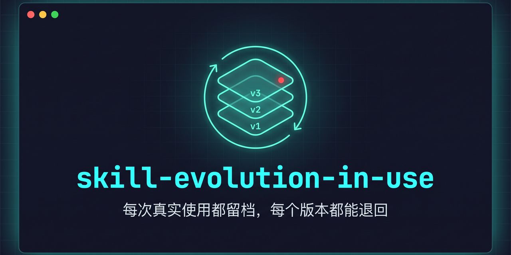

[English](README.md) | 简体中文

<div align="center">

# skill-evolution-in-use



**用到某个 Claude Code skill 的真实对话全部留档，这个 skill 的每个版本都能退回。**

[](LICENSE)
[]()
[]()
[]()

</div>

---

## 特点

1. **看得到 skill 实际怎么被用。** 每次调用它的对话都存在 skill 旁边。你问了什么、纠正了什么，回头都能翻到。
2. **改坏了随时退回。** skill 的每次改动都存成一个带编号的版本，想回哪版回哪版。退回这一步本身也能撤销。
3. **干活时零开销。** 记录不消耗 token，也不往对话里插任何输出。
4. **对话只留在你电脑上。** 记录放在 skill 自己的文件夹里，git 不会收进去。
5. **每份记录都标着当时的版本。** 以后改 skill 时，你能对上是哪段文字引出了哪次抱怨。

---

## 介绍

这是一个 Claude Code skill。你挑一个想改进的 skill，给它开启进化。之后每个调用到它的对话，都会被抄进 `<skill>/evolve/records/`。

抄下来的内容有三类。你和 Claude 说的话一字不改。每次工具调用记一行。工具报错原样保留。skill 的文件按版本编号存档，你用一句话就能退回任意一版。

做这个是因为测试题看不出真实使用里的问题。你一遍遍手动纠正的地方，最能说明 skill 哪里写错了。可窗口一关，这些纠正就没了。

这一版只管记录和存版本，不会改你的 skill。下一阶段会根据记录提出修改，先经过独立审查，口味类的改动要你点头。这一阶段还在手动试验，没有放进这一版。

---

## 展示

你有一个做幻灯片的 skill，叫 `slide-maker`。先开启：

```
你 ❯ 给 slide-maker 开启进化

[skill-evolution-in-use] enabled: slide-maker · v1 · 3 files stored
[skill-evolution-in-use] data folder: ~/.claude/skills/slide-maker/evolve/
[skill-evolution-in-use] hooks: installed in ~/.claude/settings.json (Stop, SessionEnd); recording starts in the NEXT Claude Code session (hooks load at session start)
[skill-evolution-in-use] the skill's own files were not modified
```

接下来几天你用了它三次，其中两次都在纠正同一件事：标题太长，压成一行。两次纠正都原样进了记录：

```
## Turn 2 · 11-16 10:00

**User**

> Again two-line titles. One line please
```

两次使用之间，你手动改了 `references/layout.md`。后来又一次改动把 skill 改坏了：

```
你 ❯ slide-maker 改坏了，退回上一版

[skill-evolution-in-use] unsaved edits were stored first as v3
[skill-evolution-in-use] rolled back: slide-maker now has the content of v2, stored as v4
[skill-evolution-in-use] to undo this rollback: evo.py rollback slide-maker v3

你 ❯ slide-maker 现在什么状态？

[skill-evolution-in-use] slide-maker
  state      enabled · unlocked · v4
  live copy  matches v4
  records    3 file(s) · 2 KB · latest 2026-11-16 10:00
  versions   v1 (enable) · v2 (external) · v3 (external) · v4 (rollback)
  recent     v2 · 2026-11-16 10:00 · external — edited outside skill-evolution-in-use (noticed when the skill was used)
  recent     v3 · 2026-11-16 10:00 · external — unsaved edits stored before a rollback
  recent     v4 · 2026-11-16 10:00 · rollback — restored the content of v2
  folder     ~/.claude/skills/slide-maker/evolve/ · 7 KB
  hooks      installed (Stop, SessionEnd)
```

你手动的那次修改，在下一次用到 skill 时自动存成了 v2。改坏的状态存成了 v3，想要还能拿回来。什么都没丢。

以上输出来自对一个测试 skill 的真实运行，只把文件夹路径缩短了。

---

## 仓库结构

```text
skill-evolution-in-use/
├── SKILL.md                 # Claude 读的说明：什么时候用这个 skill，每种请求对应哪条命令
├── scripts/
│   ├── evo.py               # 命令行入口，SKILL.md 里每种请求对应它的一条子命令
│   ├── evo_core.py          # evo.py 每条命令背后的实现
│   └── record_hook.py       # 每轮回答完和窗口关闭时运行，负责写记录
├── references/
│   └── record-format.md     # 记录文件和 evolve/ 文件夹的格式说明
├── evals/
│   └── evals.json           # 开发时用的 3 道测试题和检查项
├── tests/
│   └── test_p1.py           # 100 个单元测试，都在临时文件夹里跑，不碰 ~/.claude
├── assets/
│   ├── hero-en.png          # 英文 README 的顶部图
│   └── hero-zh.png          # 本页的顶部图
├── .gitignore               # 让 git 忽略 Python 缓存和 evolve/ 文件夹
├── LICENSE                  # MIT 许可证
├── README.md                # 英文 README
└── README.zh-CN.md          # 本页
```

---

## 安装

需要 Claude Code、Python 3.9 或更新版本，系统为 macOS 或 Linux。

```bash
git clone https://github.com/Zane456/skill-evolution-in-use ~/.claude/skills/skill-evolution-in-use
```

装好后在 Claude Code 里说「给 <你的 skill> 开启进化」。

第一次开启会做两件事：

- 往 `~/.claude/settings.json` 加两条 hook，并在旁边留一份备份。hook 是 Claude Code 在固定时刻自动运行的脚本，这里是每轮回答完和窗口关闭时
- 如果你没装 [skill-checkup](https://github.com/Zane456/skill-checkup)，会自动下载，下一阶段要用它检查改动。下载失败也照常开启

从下一个 Claude Code 窗口开始记录。

想停的话，说「关闭 <你的 skill> 的进化」就停止记录。要把 hook 也拿掉，运行 `python3 ~/.claude/skills/skill-evolution-in-use/scripts/evo.py uninstall-hooks`。

跑测试：

```bash
python3 ~/.claude/skills/skill-evolution-in-use/tests/test_p1.py
```

<div align="center">

MIT License © [Zane456](https://github.com/Zane456)

</div>
